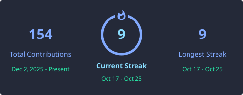

<!-- ============ HEADER ============ -->

 

## 🧰 &nbsp;tools

  
  
  
  
  
  
  
  
  

---

## 🧪 &nbsp;projects

| Project | What it's about | Stack |
| :-- | :-- | :-- |
| **[Terminology Manager](https://github.com/karlameddel/gestor_terminologico)** | Manage and translate terms across multiple languages, all in one place. | `Python` |

> more to come. the lab is always open 🔬

---

## 🌱 &nbsp;currently exploring

- &nbsp;Machine Learning & AI
- &nbsp;App development & intuitive UI/UX design
- &nbsp;Data storytelling

---

**stay tuned** &nbsp;✨

 

